<div align="center">



<a href="https://github.com/AzmuthDev">
  
</a>

<p>
  <a href="https://www.linkedin.com/in/jos%C3%A9-eduardo-ramos-04929a341"></a>
  <a href="https://instagram.com/joseduardo.rms"></a>
  <a href="https://discord.gg/eduard0.exe_82209"></a>
</p>


</div>

<br/>

## ⌚ `$ whoami`

```ts
const eduardo = {
  role:        ["Full Stack Developer", "Automation Expert"],
  company:     "Googlar",
  building:    ["Full Stack applications", "n8n automation ecosystems"],
  learning:    ["Backend architecture", "Software security"],
  collabOn:    ["Open-source automation tools", "AI agent integration"],
  askMeAbout:  ["n8n workflows", "Supabase", "hardware setup", "automating complex processes"],
  motto:       "If I do it twice, it becomes a workflow.",
  lifeGoal:    "Build a real Omnitrix ⌚",
};
```

<table>
  <tr>
    <td width="33%" valign="top">
      <h3>🔭 Building</h3>
      Full Stack apps and advanced <b>n8n</b> automation ecosystems — from the database to the last webhook.
    </td>
    <td width="33%" valign="top">
      <h3>🧠 Learning</h3>
      Refining <b>backend architecture</b> and going deeper into <b>software security</b>.
    </td>
    <td width="33%" valign="top">
      <h3>🤝 Open to</h3>
      Open-source <b>automation tools</b>, <b>AI agents</b> and projects that push my limits.
    </td>
  </tr>
</table>

<br/>

## 🛸 The Omnitrix Playlist

> Every hero has a transformation for each problem. These are mine.

| | Alien | Power | My version |
|:-:|---|---|---|
| ⚡ | **XLR8** | Super speed | **n8n** workflows that turn hours of manual work into seconds |
| 🧠 | **Grey Matter** | Genius intellect | **TypeScript** + **NestJS** backend architecture |
| 🤖 | **Upgrade** | Merges with any tech | **AI agents** plugged into real business processes |
| 💎 | **Diamondhead** | Unbreakable armor | Studying **software security** to harden what I ship |
| 💪 | **Four Arms** | Heavy lifting | **Docker**, **Supabase** and **Postgres** carrying production |
| 🔥 | **Heatblast** | Raw creative fire | **Figma**, **Framer** and **Blender** for design and 3D |

<br/>

## 🧰 Tech Arsenal

<div align="center">

<table>
  <tr>
    <td align="center" width="140"><b>Languages</b></td>
    <td></td>
  </tr>
  <tr>
    <td align="center"><b>Frontend</b></td>
    <td></td>
  </tr>
  <tr>
    <td align="center"><b>Backend & Data</b></td>
    <td></td>
  </tr>
  <tr>
    <td align="center"><b>Cloud & DevOps</b></td>
    <td></td>
  </tr>
  <tr>
    <td align="center"><b>Design & 3D</b></td>
    <td></td>
  </tr>
  <tr>
    <td align="center"><b>Automation & more</b></td>
    <td>
      
      
      
      
      
    </td>
  </tr>
</table>

</div>

<br/>

## 🚀 Latest Missions

<div align="center">

<a href="https://github.com/AzmuthDev/casa-de-bolos-maria-alice"></a>
<a href="https://github.com/AzmuthDev/Dashboard-Googlar"></a>
<a href="https://github.com/AzmuthDev/AgenteRush"></a>
<a href="https://github.com/AzmuthDev/qualipix-site"></a>

</div>

<br/>

## 📊 Power Levels

<div align="center">


<picture>
  <source media="(prefers-color-scheme: dark)" srcset="https://raw.githubusercontent.com/AzmuthDev/AzmuthDev/output/github-snake-dark.svg"/>
  <source media="(prefers-color-scheme: light)" srcset="https://raw.githubusercontent.com/AzmuthDev/AzmuthDev/output/github-snake.svg"/>
  
</picture>

</div>

<br/>

## 🏆 Trophies

<div align="center">


</div>

<br/>

<details>
<summary><b>⌚ Tap to slam the Omnitrix — curiosities about me</b></summary>
<br/>

- 🎯 **Life goal:** build a real Omnitrix. Until then, I automate everything I can.
- 🔁 **Rule of two:** if I do something twice by hand, the third time is a workflow.
- 🛠️ I care about my **hardware setup** almost as much as my code.
- 🎨 Code isn't my only canvas: I design in **Figma/Framer** and model in **Blender**.
- 🧩 Ask me how to automate something that looks impossible. That's my favourite kind of problem.

</details>

<div align="center">

<br/>


</div>
